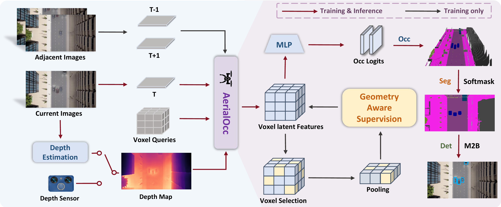

# AerialOcc

**Unified 3D Aerial Perception without Task-specific Heads**

Maintainer: [gu_xiang](https://github.com/guxiang2002)

## Introduction

We present AerialOcc, a unified aerial perception model built upon a novel architectural paradigm centered on semantic scene completion. Our model leverages the dense voxel-level outputs inherent in semantic occupancy, converting them into the formats required by other vision-centric tasks. AerialOcc supports scene-, region-, and instance-level perception within a unified architecture, without the need to design a separate task-specific head for each task.

## Method

[](docs/assets/aerialocc_method.pdf)

Overview of AerialOcc. Given adjacent and current aerial images, together with
estimated or sensor-provided depth maps, AerialOcc constructs 3D voxel latent
features through voxel queries and geometric feature encoding. The voxel
features are processed by a MLP to predict semantic occupancy logits, while
geometry aware supervision is applied to refine voxel feature. The refined
occupancy volume serves as a unified 3D scene representation, from which semantic
segmentation and object detection are derived through occupancy-based
post-processing.

## Getting Started

### Installation

```bash
git clone https://github.com/guxiang2002/AerialOcc.git
cd AerialOcc
```

Refer to [install.md](docs/install.md) to install the environment.

### Dataset

Download **AerialOcc-20K** from
[ModelScope](https://www.modelscope.cn/datasets/HHUguxiang/AerialOcc-20K).
See [dataset.md](docs/dataset.md) for data preparation and the directory layout.

```bash
export AERIALOCC_DATA_ROOT=/path/to/AerialOcc-20K
```

### Training

Prepare the input depth, training-only teacher cache and initialization weights
as described in [dataset.md](docs/dataset.md) and [install.md](docs/install.md).

```bash
python main.py --config_path configs/aerialocc20k.py
```

### Occupancy Inference

```bash
python main.py --config_path configs/aerialocc20k.py --eval --ckpt_path /path/to/model.ckpt --save_path outputs/predictions
```

### Segmentation and Detection

```bash
python tools/aerialocc_export_occ.py --config configs/aerialocc20k.py --checkpoint /path/to/model.ckpt --output outputs/export

python tools/aerialocc_eval26.py --manifest outputs/export/frames.json --gt-label-space contiguous --task occ-seg --output outputs/export/seg26.json

python tools/aerialocc_eval26.py --manifest outputs/export/frames.json --gt-label-space contiguous --task det --output outputs/export/det26.json

python tools/aerialocc_eval26.py --manifest outputs/export/frames.json --gt-label-space contiguous --task all --output outputs/export/all26.json
```

### Visualization

```bash
python tools/aerialocc_visualize.py --data-root "$AERIALOCC_DATA_ROOT" --pred-root outputs/predictions --scene scene_16 --frame 000000 --output-root outputs/visualizations
```

See [visualization.md](docs/visualization.md) for additional options.

## Model Zoo

Trained weights are hosted on [ModelScope](https://www.modelscope.cn/models/HHUguxiang/AerialOcc).

| Model | Dataset | Backbone | Image size | Global step | Weights | Config |
| --- | --- | --- | --- | --- | --- | --- |
| AerialOcc | AerialOcc-20K | EfficientNet-B7 | 704 x 384 | 25,000 | [best.ckpt](https://www.modelscope.cn/api/v1/models/HHUguxiang/AerialOcc/repo?Revision=master&FilePath=aerialocc20k%2Fbest.ckpt) | [config](configs/aerialocc20k.py) |

| Validation frames | OCC IoU (%) | mIoU (%) |
| --- | --- | --- |
| 4,000 | 69.0187 | 29.9288 |

The download contains the native 25,000-step checkpoint, including optimizer and
scheduler states, and matches `configs/aerialocc20k.py`.

```bash
wget -O best.ckpt 'https://www.modelscope.cn/api/v1/models/HHUguxiang/AerialOcc/repo?Revision=master&FilePath=aerialocc20k%2Fbest.ckpt'
python main.py --config_path configs/aerialocc20k.py --eval --ckpt_path best.ckpt --save_path outputs/predictions
```

See [checkpoint metadata and validation protocol](docs/model_zoo.md) for SHA-256
and evaluation details.

## Acknowledgement

Many thanks to these exceptional open source projects:

- [CGFormer](https://github.com/pkqbajng/CGFormer)
- [BEVFormer](https://github.com/fundamentalvision/BEVFormer)
- [mmdet3d](https://github.com/open-mmlab/mmdetection3d)
- [MonoScene](https://github.com/astra-vision/MonoScene)
- [semantic-kitti-api](https://github.com/PRBonn/semantic-kitti-api)
- [MobileStereoNet](https://github.com/cogsys-tuebingen/mobilestereonet)
- [Symphonize](https://github.com/hustvl/Symphonies.git)
- [DFA3D](https://github.com/IDEA-Research/3D-deformable-attention.git)
- [VoxFormer](https://github.com/NVlabs/VoxFormer.git)
- [OccFormer](https://github.com/zhangyp15/OccFormer.git)

As it is not possible to list all the projects of the reference papers. If you find we leave out your repo, please contact us and we'll update the lists.

## Contact

Please open an [issue](https://github.com/guxiang2002/AerialOcc/issues) for
questions about AerialOcc.
